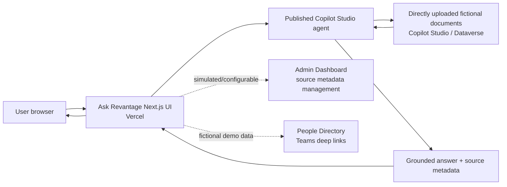
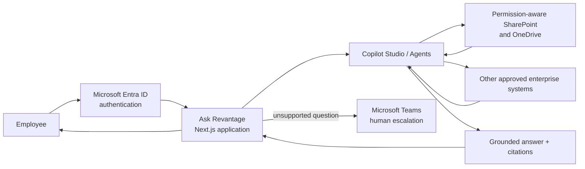

# Ask Revantage

**One question. One place. One answer.**

Ask Revantage is a custom Next.js employee-help experience connected to a published Microsoft Copilot Studio agent. The assistant identity is **Ask Revant Bot**. Copilot Studio produces the answers and citation metadata; the repository contains no hardcoded policy answers.

## Current experience

- Custom glassmorphism UI with persistent light and dark themes
- Exactly three suggested prompt pills inside the chat window and no separate prompt panel
- Bot icon throughout the chat—no sparkle icon
- Real Copilot Studio answers and citation metadata
- Source cards with clear file-type icons and concise **Open** and **Download** actions when a valid URL is returned
- Classy Knowledge Library titled **Ask Revantage - Hackathon Knowledge Base**
- Searchable **People Directory** with fictional hackathon profiles and Microsoft Teams chat links
- Human escalation for unsupported questions
- Dynamic **Admin Dashboard** with no seeded source or policy records
- Responsive navigation, chat, Knowledge Library, People Directory, and Admin Dashboard
- Single-source URL navigation in a shared workspace layout, with no duplicate content flash and full back/forward support
- A concise demo knowledge-base fact below the loader that rotates every four seconds and stays static when reduced motion is preferred
- Dedicated metadata, favicon, manifest, 1200×630 Open Graph image, and Twitter preview image
- Local Shruti Gupta avatar at `public/assets/avatars/shruti-gupta.jpg`, a raster PNG for Ethan Brooks, and separate illustrated fictional admin avatars

## Current hackathon implementation



- The live hackathon chat uses a secured Direct Line token exchange and the published Copilot Studio agent.
- Knowledge documents are fictional and uploaded directly to Copilot Studio; they are not bundled policy answers in this repository.
- Source cards are generated from citation metadata returned by the agent.
- Admin source additions are simulated in browser storage unless `DATA_SOURCE_API_URL` is configured.
- People Directory profiles and UPNs are fictional. Teams deep links demonstrate the intended handoff pattern.

## Production / actual-user architecture



- Microsoft Entra ID would establish the employee identity and application session.
- Copilot Studio/Agents would retrieve only knowledge the employee is authorized to access.
- SharePoint, OneDrive, and other approved systems would remain permission-aware sources rather than public repository content.
- Grounded responses would retain source citations and audit-friendly metadata.
- Unsupported questions would move to approved people or queues through Microsoft Teams.

## Tools used to build Ask Revantage

| Tool | How it was used |
|---|---|
| Microsoft Copilot | Research, planning, requirements refinement, content drafting, and AI-assisted development. Human review and verification remained part of the workflow. |
| Microsoft Copilot Studio | Published conversational agent, directly uploaded fictional knowledge, grounded answers, and citation metadata. |
| Direct Line API | Secure conversation channel between the custom browser UI and Copilot Studio; the server exchanges the secret for a short-lived conversation token. |
| GitHub | Public source control and hackathon submission repository. |
| GitHub Codespaces | Browser-based development, dependency installation, type checking, and build verification where local tools are restricted. |
| Next.js + TypeScript | Application framework, route metadata, server endpoints, secure token exchange, and typed client behavior. |
| Tailwind CSS | Responsive layout, component styling, accessibility states, and the custom glassmorphism interface. |
| Vercel | Next.js build, hosting, serverless API routes, and protected environment variables. |
| OneDrive / SharePoint patterns | Production-ready, permission-aware source patterns and dynamic document-link targets; not used for end-user retrieval in the current direct-upload hackathon flow. |
| Microsoft Teams | Human-escalation target through deep links; current directory identities are fictional demonstration data. |
| Python / Pillow | Local preparation of favicon and social-preview image assets; not required by the production runtime. |
| Hype4 glassmorphism reference | Visual reference for blur, refraction edges, translucency, and depth treatment. |

### AI-assisted development disclosure

Ask Revantage was developed with Microsoft Copilot assistance for research, design iteration, code generation, debugging, and documentation. The implementation was reviewed and tested against the stated hackathon requirements. AI assistance is disclosed here transparently; it does not replace security review, accessibility review, data-governance approval, or production engineering controls.

## Secure Copilot Studio integration

```text
Browser
  │ POST /api/copilot/token
  ▼
Next.js server on Vercel
  │ Uses COPILOT_STUDIO_DIRECT_LINE_SECRET
  │ Exchanges secret at /v3/directline/tokens/generate
  ▼
Short-lived, single-conversation token
  │
  ▼
Browser Direct Line conversation
  │
  ▼
Published Copilot Studio agent
  └─ Real answer activities + schema.org citation metadata
```

The Direct Line secret never enters browser code or an API response. The browser receives only a short-lived conversation token. The token request binds an unguessable `dl_` user ID and trusted origins derived from `NEXT_PUBLIC_SITE_URL` and the current request origin.

The custom client keeps one conversation until **New conversation** is selected and refreshes the token before expiry. Before each question, it advances the Direct Line watermark and marks stale activities as seen. It then posts the question and polls asynchronously for up to 75 seconds, accepts agent messages even when Direct Line omits `from.role`, correlates activities to the current turn, deduplicates activity IDs, waits for a completed answer, normalizes citations, and surfaces human escalation when the answer is outside the agent's knowledge.

## Required Copilot Studio settings

1. Keep the hackathon documents uploaded directly to the agent and marked **Ready**.
2. Publish the latest agent version.
3. Under **Settings → Security → Web channel security**, turn on **Require secured access**.
4. Copy either Web channel security secret.
5. Confirm generative answers return source citations.

OneDrive end-user authentication is not required for answer retrieval because Copilot Studio retrieves the directly uploaded knowledge.

## Required Vercel settings

Set these for Production and any Preview environment used for testing:

```text
COPILOT_STUDIO_DIRECT_LINE_SECRET=<Copilot Studio Web channel security secret>
NEXT_PUBLIC_SITE_URL=https://your-production-domain.vercel.app
```

Optional:

```text
COPILOT_STUDIO_DIRECT_LINE_BASE_URL=https://directline.botframework.com
```

Redeploy after changing variables. Never expose the Direct Line secret through `NEXT_PUBLIC_`, and never commit it to GitHub.

## Knowledge Library and OneDrive document URLs

The library name is **Ask Revantage - Hackathon Knowledge Base**. The UI contains no embedded document records. It builds the library from citation metadata returned during the current Copilot conversation.

The UI detects folder, PDF, Word/DOCX, Excel/XLSX, PowerPoint/PPTX, and generic file types. **Open** and **Download** appear only for valid HTTP or HTTPS URLs.

For production OneDrive-backed content, supply document URLs dynamically through approved Copilot citation metadata or a server-side integration. Use organization-scoped OneDrive/SharePoint sharing links or approved `webUrl` values that the signed-in user can open. Do not place confidential URLs, item IDs, access tokens, or document contents in source code. Cross-origin host security and content-disposition settings determine whether **Download** saves immediately or opens the source first.

## People Directory and Teams targets

All built-in profiles and UPNs are fictional hackathon data. Teams actions use:

```text
https://teams.microsoft.com/l/chat/0/0?users=<encoded-UPN>
```

If a profile has no `teamsUpn`, the action is disabled with an accessible fallback.

For production, provide people dynamically from an approved server-side service:

```text
PEOPLE_DIRECTORY_API_URL=https://your-approved-service.example/api/people
PEOPLE_DIRECTORY_API_TOKEN=<optional server-side bearer token>
```

The service can return an array or `{ "people": [...] }` containing `id`, `name`, `title`, `department`, `location`, `expertise`, `categories`, `response`, `avatar`, and optional `teamsUpn`. Do not commit real employee lists, confidential UPN exports, or tokens to this public repository.

## Admin Dashboard

The Admin Dashboard starts with no source records. It reports Copilot Studio status from server configuration and offers production-aligned connector choices:

- Copilot Studio agent/direct-upload knowledge
- Microsoft SharePoint and Microsoft OneDrive
- PDF/file upload, Word, Excel, and PowerPoint
- Website/URL

In browser-only hackathon mode, adding a source stores metadata locally and labels it **Prototype configured**. It does not claim to authenticate, upload, index, or sync the source. For a real management service, configure:

```text
DATA_SOURCE_API_URL=https://your-service.example/api/sources
DATA_SOURCE_STORE=Server-managed
```

The server then proxies `GET`, `POST`, `PATCH`, and `DELETE` through `/api/admin/sources`. Credentials belong in the server service or managed secret store.

## Session personas

- Normal experience: **Shruti Gupta** with the supplied local photo, including alongside user messages.
- Admin Dashboard: a separate fictional admin selected once per browser session, with role **Admin user** and a different avatar.

The Admin Dashboard never uses Shruti Gupta's photo for the fictional admin persona.

## Routes and metadata

| Route | Purpose |
|---|---|
| `/` | Ask Revant Bot chat |
| `/knowledge` | Dynamic Knowledge Library from live citations |
| `/people` | Fictional People Directory and Teams actions |
| `/admin` | Dynamic Admin Dashboard |

Each route has dedicated metadata. The branded preview image is `public/og/ask-revantage.png` and is also exposed through `app/opengraph-image.png`.

## Run and deploy

```bash
npm install
npm run typecheck
npm run build
npm run dev
```

```bash
git add .
git commit -m "Fix Direct Line responses, loading trivia, avatars, and navigation"
git push origin main
```

Vercel should deploy automatically. Test both themes, all three prompts, the four-second waiting trivia, a delayed cited answer, source actions, unsupported-question escalation, Ethan Brooks's PNG avatar, People Directory search and Teams links, back/forward navigation, mobile navigation, and Admin Dashboard source simulation.

## Brand implementation

The supplied logo is preserved. The application uses approved Revantage colors and Georgia/Arial fallbacks. Glass surfaces use 20px backdrop blur, refraction edges, accessible focus states, reduced-motion handling, and solid fallbacks where backdrop filters are unavailable.
