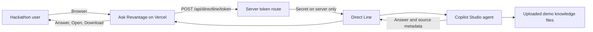
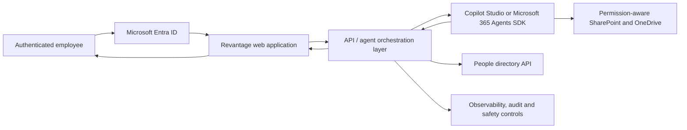

# Ask Revantage

Ask Revantage is a responsive internal knowledge-assistant demonstration built with Next.js and Microsoft Copilot Studio. The custom chat UI obtains a short-lived Direct Line conversation token from a server-only route, waits for a substantive final answer, and collects source metadata returned with grounded responses.

> All People Directory records, addresses, and source-configuration actions are fictional demonstration data. The source selector does not claim that ingestion occurred.

## Included in this root-ready package

- Bot identity is **Ask Revantage Bot** everywhere.
- Large, responsive chat workspace that uses the available browser area at 100% zoom.
- Three suggested prompts inside the chat window only.
- Visible loader and policy trivia that rotates every four seconds while the answer is prepared.
- Direct Line token generation followed by explicit conversation start, user/token/conversation pairing, proactive token refresh, watermark polling, stale-session recovery, and a three-minute final-answer window.
- Secure GitHub-Flavored Markdown rendering for Copilot responses, including headings, emphasis, lists, tables, paragraphs, code, blockquotes, and safe links. Raw HTML is skipped and unsafe URL schemes are rejected.
- Citation parsing across Direct Line activity entities, attachments, channel data, markdown links, and nested schema.org citation/appearance records. Copilot-returned HTTP(S) document URLs are preserved rather than reconstructed from filenames.
- Clickable source-document cards with explicit **Open** actions. PDF sources use a recognizable PDF icon and open the actual returned PDF/document URL in a new tab. Download is shown only for an explicit download URL or a direct file URL.
- Knowledge Library populated from the same source names and real URLs returned in the current browser. Filename-only citations remain visible but are clearly unavailable and never receive fabricated Open or Download actions.
- Admin Dashboard with recognizable local SVG assets and responsive connector-specific setup forms for Copilot Studio, SharePoint, OneDrive, Word, Excel, PowerPoint, PDF/file upload, and Website.
- People Directory email actions use `mailto:` and never open Teams.
- Distinct local JPG/PNG profile assets for every People Directory profile.
- Complete Ask Revantage wordmark in the responsive navigation without desktop or mobile cropping.
- Light and dark themes, responsive navigation, reduced-motion support, keyboard focus states, Open Graph metadata, favicon, and link-preview image.
- Canonical route-group structure with cleanup for obsolete duplicate routes and superseded legacy modules.
- Patched Next.js 16.4.5 and a minimal PostCSS configuration for the authored CSS, with no unused Tailwind plugin dependency.

## Local and Codespaces setup

Node.js 20.9 or later is required.

```bash
npm install
npm run verify
npm run dev
```

Open `http://localhost:3000`.

### Environment variables

Create `.env.local` for local development. In Vercel, add the same sensitive value as an encrypted Secret.

```text
DIRECT_LINE_SECRET=<Copilot Studio Direct Line web-channel secret>
DIRECT_LINE_TRUSTED_ORIGINS=http://localhost:3000,https://your-app.vercel.app
NEXT_PUBLIC_SITE_URL=https://your-app.vercel.app
```

The token route also accepts the legacy `COPILOT_STUDIO_DIRECT_LINE_SECRET` variable name, but `DIRECT_LINE_SECRET` is the preferred name.

Optional future integrations:

```text
DATA_SOURCE_API_URL=
DATA_SOURCE_STORE=
PEOPLE_DIRECTORY_API_URL=
PEOPLE_DIRECTORY_API_TOKEN=
```

## GitHub Codespaces to Vercel

1. Upload or extract this ZIP at the repository root.
2. Run:

   ```bash
   npm install
   npm run verify
   ```

3. Commit all changes, including removals of obsolete routes and modules:

   ```bash
   git add -A
   git commit -m "Complete Ask Revantage UI and build fixes"
   git push origin main
   ```

4. Confirm the Vercel project has `DIRECT_LINE_SECRET`, `DIRECT_LINE_TRUSTED_ORIGINS`, and `NEXT_PUBLIC_SITE_URL` for the environments you use.
5. Redeploy after changing environment variables.

The previous PostCSS failure is removed at its source. The interface uses authored CSS, so `postcss.config.mjs` now has no Tailwind plugin and `package.json` no longer installs unused Tailwind dependencies.

The pre-typecheck and prebuild cleanup also removes files left behind by older ZIP releases. Those legacy files imported `SupportRequest`, `KnowledgeSource`, `AdminIcon`, and `ChatIcon`, included an untyped CommonJS classifier, and included `context/chat-context.tsx`, which imported the superseded `lib/direct-line-client` module. The current chat uses `components/chat-view.tsx` with `lib/directline.ts`, so deleting the stale files is safer than restoring incompatible compatibility modules.

## Current hackathon architecture



## Production architecture



Production work should add enterprise authentication, delegated authorization, tenant permission checks, centralized source governance, telemetry, rate limits, content-safety controls, retention rules, accessibility testing, security review, and named service ownership.

## Tools and responsibilities

| Tool | Current use |
| --- | --- |
| Next.js | App Router, metadata, server-side token route, Vercel deployment |
| React | Stateful chat, theme, navigation and responsive views |
| react-markdown + remark-gfm | Safe rendering for Copilot Markdown, including tables and lists |
| Microsoft Copilot Studio | Agent orchestration and grounded knowledge responses |
| Direct Line | Short-lived browser conversation token and activities |
| Local SVG/PNG/JPG assets | Product logos, Open Graph image, favicon and avatars |
| PostCSS | Minimal build configuration for the app’s authored CSS |
| GitHub Codespaces | Browser-based install, validation, commit and push workflow |
| Vercel | Hosting, environment variables and automatic deployment |

## Security model

- The Direct Line secret is read only in `app/api/directline/token/route.ts`.
- The server generates a user-bound token and immediately starts that exact reserved conversation before returning the paired conversation ID, short-lived token, and normalized Direct Line user ID to the browser.
- The browser refreshes the same conversation token before expiry. A refreshed token is rejected if its conversation ID does not match.
- HTTP activity polling uses the documented conversation activities URL and replays the exact watermark. It does not reuse expired WebSocket stream URLs.
- Invalid legacy, expired, incomplete, unauthorized, or missing persisted sessions are cleared as a unit and restarted once; a new token is never attached to an old conversation ID.
- `DIRECT_LINE_TRUSTED_ORIGINS` can restrict token creation to named origins.
- Token responses are marked `no-store`.
- Source links are rendered only when Copilot provides valid HTTP or HTTPS metadata. The same returned URL is used by the chat card and Knowledge Library; filenames are never converted into guessed links.
- Markdown HTML is skipped, external images are not loaded, and links are restricted to HTTP, HTTPS, `mailto:`, or same-page anchors as appropriate.
- Admin source selections and non-sensitive form fields are a clearly labelled browser-only hackathon simulation unless a real API is connected. Connector forms never request secrets; production credentials belong in approved server-side services.

## Verification

```bash
npm run typecheck
npm run verify:static
npm run build
```

`verify:static` checks the corrected bot name, email actions, required local source icons, and the PostCSS dependency. A production deployment must still be tested with the published Copilot Studio agent and the actual Vercel origin.

## AI-assisted development disclosure

This hackathon prototype was developed with AI assistance. Human reviewers remain responsible for code review, environment configuration, source permissions, production security, policy accuracy, and deployment approval.
