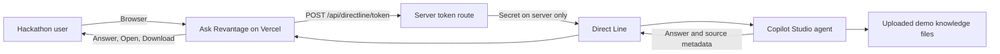
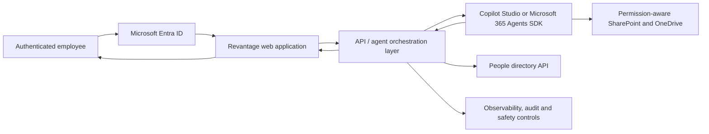

# Ask Revantage

Ask Revantage is a responsive internal knowledge-assistant demonstration built with Next.js and Microsoft Copilot Studio. The custom chat UI obtains a short-lived Direct Line conversation token from a server-only route, waits for a substantive final answer, and collects source metadata returned with grounded responses.

> All People Directory records, addresses, and source-configuration actions are fictional demonstration data. The source selector does not claim that ingestion occurred.

## Included in this root-ready package

- Bot identity is **Ask Revantage Bot** everywhere.
- Large, responsive chat workspace that uses the available browser area at 100% zoom.
- Three suggested prompts inside the chat window only.
- Visible loader and policy trivia that rotates every four seconds while the answer is prepared.
- Direct Line polling that ignores short intermediate messages and waits up to three minutes for a final response and citations.
- Knowledge Library populated from source metadata returned in the current browser.
- Admin Dashboard with recognizable, local SVG assets for Copilot Studio, SharePoint, OneDrive, Word, Excel, PowerPoint, PDF/file upload, and Website.
- People Directory email actions use `mailto:` and never open Teams.
- Local JPG/PNG profile assets, including Shruti Gupta and Ethan Brooks.
- Light and dark themes, responsive navigation, reduced-motion support, keyboard focus states, Open Graph metadata, favicon, and link-preview image.
- Canonical route-group structure with cleanup for obsolete duplicate routes and superseded legacy modules.
- Patched Next.js 16.4.5 and complete PostCSS dependency configuration.

## Local and Codespaces setup

Node.js 20.9 or later is required.

```bash
npm install
npm run verify
npm run dev
```

Open `http://localhost:3000`.

### Environment variables

Create `.env.local` for local development. In Vercel, add the same sensitive value as an encrypted Secret.

```text
DIRECT_LINE_SECRET=<Copilot Studio Direct Line web-channel secret>
DIRECT_LINE_TRUSTED_ORIGINS=http://localhost:3000,https://your-app.vercel.app
NEXT_PUBLIC_SITE_URL=https://your-app.vercel.app
```

The token route also accepts the legacy `COPILOT_STUDIO_DIRECT_LINE_SECRET` variable name, but `DIRECT_LINE_SECRET` is the preferred name.

Optional future integrations:

```text
DATA_SOURCE_API_URL=
DATA_SOURCE_STORE=
PEOPLE_DIRECTORY_API_URL=
PEOPLE_DIRECTORY_API_TOKEN=
```

## GitHub Codespaces to Vercel

1. Upload or extract this ZIP at the repository root.
2. Run:

   ```bash
   npm install
   npm run verify
   ```

3. Commit all changes, including removals of obsolete routes and modules:

   ```bash
   git add -A
   git commit -m "Complete Ask Revantage UI and build fixes"
   git push origin main
   ```

4. Confirm the Vercel project has `DIRECT_LINE_SECRET`, `DIRECT_LINE_TRUSTED_ORIGINS`, and `NEXT_PUBLIC_SITE_URL` for the environments you use.
5. Redeploy after changing environment variables.

The previous PostCSS failure is fixed because `postcss.config.mjs` and `package.json` now agree: `@tailwindcss/postcss` is explicitly installed as a development dependency. The interface uses authored CSS, but keeping the plugin dependency resolves the existing build configuration without a risky build-only workaround.

The pre-typecheck and prebuild cleanup also removes files left behind by older ZIP releases. Those legacy files imported `SupportRequest`, `KnowledgeSource`, `AdminIcon`, and `ChatIcon`, and included an untyped CommonJS classifier. The current application no longer uses that request/store/workspace-shell stack, so deleting those stale files is safer than restoring incompatible compatibility types.

## Current hackathon architecture



## Production architecture



Production work should add enterprise authentication, delegated authorization, tenant permission checks, centralized source governance, telemetry, rate limits, content-safety controls, retention rules, accessibility testing, security review, and named service ownership.

## Tools and responsibilities

| Tool | Current use |
| --- | --- |
| Next.js | App Router, metadata, server-side token route, Vercel deployment |
| React | Stateful chat, theme, navigation and responsive views |
| Microsoft Copilot Studio | Agent orchestration and grounded knowledge responses |
| Direct Line | Short-lived browser conversation token and activities |
| Local SVG/PNG/JPG assets | Product logos, Open Graph image, favicon and avatars |
| PostCSS / Tailwind PostCSS plugin | Compatible CSS build pipeline; dependency is explicitly installed |
| GitHub Codespaces | Browser-based install, validation, commit and push workflow |
| Vercel | Hosting, environment variables and automatic deployment |

## Security model

- The Direct Line secret is read only in `app/api/directline/token/route.ts`.
- The browser receives a short-lived, conversation-scoped token, never the secret.
- `DIRECT_LINE_TRUSTED_ORIGINS` can restrict token creation to named origins.
- Token responses are marked `no-store`.
- Source links are rendered only when Copilot provides HTTP or HTTPS metadata.
- Admin source selections are browser-only demonstration state unless a real API is connected.

## Verification

```bash
npm run typecheck
npm run verify:static
npm run build
```

`verify:static` checks the corrected bot name, email actions, required local source icons, and the PostCSS dependency. A production deployment must still be tested with the published Copilot Studio agent and the actual Vercel origin.

## AI-assisted development disclosure

This hackathon prototype was developed with AI assistance. Human reviewers remain responsible for code review, environment configuration, source permissions, production security, policy accuracy, and deployment approval.
