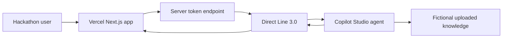
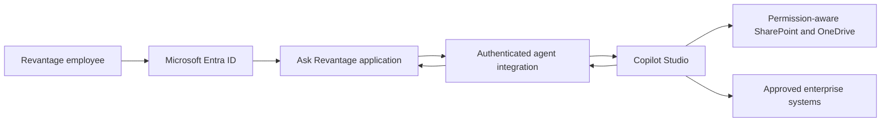

# Ask Revantage

Ask Revantage is a Next.js custom chat for a Microsoft Copilot Studio agent. This release fixes the Direct Line response lifecycle so an intermediate message such as **"Let me read the cab policy and related files"** stays in the processing state instead of ending the request.

## What changed in 4.0.0

- Treats the Direct Line `POST /activities` response as an acknowledgment only.
- Opens the preauthorized Direct Line WebSocket and reads every subsequent `ActivitySet`.
- Tracks each `watermark` verbatim and falls back to `GET /activities?watermark=...` when streaming is unavailable.
- Deduplicates activities by activity ID when WebSocket and HTTP retrieval overlap.
- Correlates bot activities to the current user activity with `replyToId` when available and timestamp boundaries otherwise.
- Classifies short progress messages, `typing` activities and progress events without completing the request.
- Keeps a visible three-dot loader and four-second rotating trivia active while progress continues.
- Waits for a substantive answer and a four-second quiet period so separately delivered citations can join the answer.
- Preserves citations and source metadata from activities, attachments, adaptive cards, entities and `channelData`.
- Renders safe **Open** and **Download** actions for returned source URLs.
- Stops only on a substantive final answer, `endOfConversation`, a terminal connection error, or the configured hard timeout.
- Refreshes the short-lived Direct Line conversation token before it expires.
- Keeps the Direct Line secret server-side.

## Current hackathon architecture



The browser receives a temporary, conversation-scoped token. It never receives the Direct Line secret.

## Production architecture



Production should use employee authentication, least-privilege access and permission-aware sources. Do not use the hackathon's unauthenticated pattern for restricted content.

## Tools used

| Tool | Role in this implementation |
|---|---|
| Next.js | Application shell, routes, server token endpoints and metadata |
| React | Persistent chat state, loader, trivia and responsive UI |
| Microsoft Copilot Studio | Agent authoring, orchestration and grounded answers |
| Direct Line 3.0 | Browser-safe conversation transport using tokens, WebSocket and watermarks |
| Microsoft Entra ID | Recommended production employee identity layer |
| SharePoint / OneDrive | Recommended production knowledge sources with source permissions |
| GitHub Codespaces | Repository editing, testing and source control workflow |
| Vercel | Next.js build, environment variables and deployment |
| Microsoft Teams | People Directory deep links |

## Configure locally

1. Copy the environment file.

   ```bash
   cp .env.example .env.local
   ```

2. Add the Copilot Studio Direct Line secret to `DIRECT_LINE_SECRET`. Never rename it with a `NEXT_PUBLIC_` prefix.
3. For the hackathon's fictional public documents, set the Copilot Studio agent to the agreed authentication mode, save, and publish the agent again. Authentication changes do not take effect until publishing.
4. Install and verify.

   ```bash
   npm install
   npm run verify
   npm run dev
   ```

5. Open `http://localhost:3000`.

## Vercel deployment

1. Extract this ZIP directly into the repository root and overwrite existing files.
2. Run the cleanup before committing. It removes stale top-level routes that conflict with `app/(workspace)`.

   ```bash
   npm install
   npm run clean:routes
   npm run verify
   git add -A
   git commit -m "Fix Direct Line final answer lifecycle"
   git push origin main
   ```

3. In **Vercel > Project > Settings > Environment Variables**, add:
   - `DIRECT_LINE_SECRET`
   - `DIRECT_LINE_TRUSTED_ORIGINS` with the deployed origin
   - optionally `NEXT_PUBLIC_SITE_URL` with the production URL
   - optionally `NEXT_PUBLIC_DIRECT_LINE_TIMEOUT_MS` (default `180000`)
4. Redeploy after changing environment variables.

## Direct Line lifecycle

1. The server exchanges the master secret for a short-lived token with an unguessable `dl_` user ID.
2. The server starts the conversation and returns the token, conversation ID and `streamUrl`.
3. The client opens one WebSocket per conversation. Direct Line permits one stream connection for a conversation.
4. Before each question, the client drains stale activities and records the current watermark.
5. The client posts the user activity. The returned activity ID is an acknowledgment and correlation key, not a bot answer.
6. Incoming activities are deduplicated and correlated. `typing`, progress events and short progress phrases update the visible processing status.
7. A substantive message becomes a final-answer candidate. A short settle window lets citation activities arrive separately.
8. If the WebSocket fails, HTTP polling continues from the last watermark. The pending request remains active.

## Verification

- `npm test` checks progress classification, final-answer classification, citation extraction, activity correlation and deduplication.
- `npm run typecheck` checks all application TypeScript.
- `npm run build` verifies the Next.js production build and route tree.
- `npm run verify` runs all three.

## Microsoft references

- Direct Line - receive activities: https://learn.microsoft.com/azure/bot-service/rest-api/bot-framework-rest-direct-line-3-0-receive-activities
- Direct Line - start conversation: https://learn.microsoft.com/azure/bot-service/rest-api/bot-framework-rest-direct-line-3-0-start-conversation
- Direct Line authentication and token refresh: https://learn.microsoft.com/azure/bot-service/rest-api/bot-framework-rest-direct-line-3-0-authentication
- Direct Line reconnect: https://learn.microsoft.com/azure/bot-service/rest-api/bot-framework-rest-direct-line-3-0-reconnect-to-conversation
- Copilot Studio authentication: https://learn.microsoft.com/microsoft-copilot-studio/configuration-end-user-authentication

## Demo data notice

The documents and directory entries in this package are fictional hackathon content. They are not Revantage policies, records or employee directory data.
